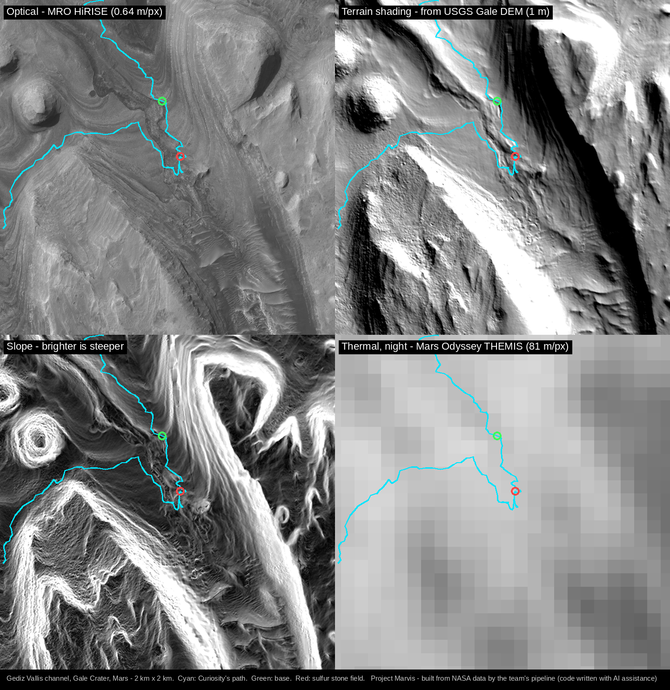
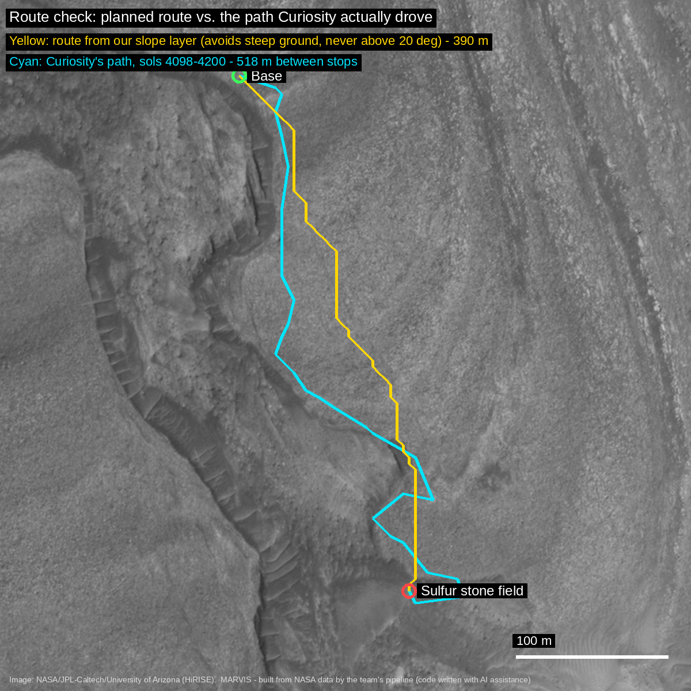

# Project Marvis

**A layered Mars map on an explorer's helmet.**
An entry for the 2026 NASA Space Apps Challenge, *Interplanetary Survival Guide: Martian Map* ([challenge text](docs/CHALLENGE.md)).

Project Marvis is a helmet heads-up display for an astronaut walking on Mars. It layers data from four NASA Mars missions into one map of a single walkable site, plans a route across it that a person in a spacesuit could walk, fills in the nearby obstacles that orbital data cannot show with the helmet's own depth sensor, and keeps the suit's readings and alerts in view. It is operated by hand gestures and voice, because gloved hands cannot press buttons. A Meta Quest 3 stands in for the helmet, an NVIDIA Jetson for the suit's computer and an Arduino temperature sensor for a sensor on the suit.

**Demo video:** [docs/demo/marswalk-visor-demo.mp4](docs/demo/marswalk-visor-demo.mp4), a recording of the headset's view with the app in use (29 s).



*The four map layers over the same 2 km × 2 km of Gediz Vallis channel, with the path Curiosity drove. A plot of NASA data drawn by our script.*

The project was called Marswalk Visor, then MARVIS. Names in the code keep the older names: the Python package `marswalk`, the `MARSWALK` hotspot, the "Start MARVIS" launcher, file names such as `marswalk-visor-demo.mp4`, and the line under the two figures.

## Mission scenario

The site is Gediz Vallis channel on Mount Sharp, Gale Crater: a 2,048 m × 2,048 m square centered on 137.4075° E, 4.7868° S. On May 30, 2024 (sol 4200) Curiosity cracked a rock open here and found pure sulfur, a first on Mars, and it is not yet known why it formed here. The premise is that a crew returns on foot to survey the sulfur field more widely.

- **Survey site:** where Curiosity ended its drive that day, 137.4089° E, 4.7857° S.
- **Base:** where Curiosity stood on sol 4098, 358 m away in a straight line and 45 m lower. Curiosity drove 593 m between the two, so the planned route can be compared with a path a real vehicle took.

## What it does

The start page offers two modes, **Mars map** and **Field map**.

- **Mars map on the palm.** Turning the left palm up brings up a 3D relief of the site, to scale. It shows one of four layers (elevation, slope, optical image, night thermal image), with the path Curiosity drove, the base and the survey site drawn on it.
- **Route planner for a walker in a suit.** Routes come from the slope layer: ground gets more expensive past 15° and is closed above 20°. The route from base to the survey site is 390 m long, climbs 45 m and never crosses ground steeper than 14.9°. It is drawn on the map and laid on the real floor as arrows. On a critical alert it leads back to base.
- **Field map with a live obstacle scan.** The second mode shows the ground around the wearer, 24 m across. The headset's room geometry and live depth image become a floor grid of 10 cm cells: clear floor, obstacles, drops. The route to a target goes around the obstacles, and walking into marked ground raises a warning. The map is kept on the Jetson for the next session. In the demo a room plays the Martian ground: the scan stands for the rocks and ledges that orbital data cannot show.
- **Targets and waypoints.** Pointing at the map and pinching picks a place, which becomes the target of the route or a waypoint. A waypoint can be named by voice.
- **HUD with vitals and alerts.** Readings stand as tiles beside the line of sight: battery, oxygen and ambient temperature always, and whatever else matters most at the moment. An open right palm shows a figure of the wearer with the vitals around it. An alert brings up a card, beeps and lights the view in orange or red. Alerts exist for the ambient temperature (30 °C and 35 °C), for radiation well above what Curiosity measured here, and for a lost link to the hub.
- **Menus without touching.** The back of the left hand, turned up as when looking at a watch, brings up a card of commands. The right hand points at it and pinches.
- **Voice commands through the Jetson hub.** Short English commands such as "Navigate", "Base", "Mark waypoint", "Thermal", "Status". Speech is recognized and answered on the Jetson with no internet connection. What was heard is matched against a table of phrases the team wrote, not by a language model.
- **Suit temperature sensor.** An Arduino sends one reading a second to the hub, which decides when an alert starts and clears. It measures the air around the wearer, so the app calls it the ambient temperature.
- **Rescue signal.** The red SOS bar on the command card, or saying "SOS", arms it; "Confirm" sends it. The hub raises an alert on every other headset and on the monitor page. The crew is simulated: the hub acknowledges in its name after five seconds and says so.
- **Monitor page.** A page served by the hub shows the wearer's whole view live, with no Meta account and no developer mode, and records it with the voices as MKV and MP4.

**Measured and simulated.** The battery is the headset's own and the ambient temperature comes from the sensor. Radiation, air pressure and air temperature are Curiosity's record of one Martian day, replayed. Oxygen, heart rate, suit pressure and body temperature are simulated and marked "sim". The photos Curiosity took at the base and at the survey site are prepared in the data (`pov.json`), but the app does not show them yet.

How each part behaves in the hand, with the switches that can be put after the address, is in [docs/USAGE.md](docs/USAGE.md).

## NASA data

The map, the route, the radiation and weather readings and the radiation alert start from NASA mission data. Not NASA data: the headset's own sensors (tracking, depth, battery) with the field map made from them, the temperature sensor with its alerts, and the simulated vitals, which are marked "sim". They act on top of the map and the route.

| Layer | Kind | Mission · instrument | Source | What it became in the app |
|---|---|---|---|---|
| Terrain elevation | topographic | MRO HiRISE·CTX, Mars Express HRSC, MGS MOLA | [USGS Gale 1m DEM](https://astrogeology.usgs.gov/search/map/mars_msl_gale_merged_dem_1m) | An elevation grid of 512 × 512 cells of 4 m; the relief of the palm map is drawn from it with a vertex every 8 m |
| Slope | derived | Same as above | Computed from terrain | Map layer; the cost of the route planner |
| Optical image | optical | MRO · HiRISE | [Mars Trek](https://trek.nasa.gov/mars/) | Map layer: 182 tiles joined, about 0.64 m per pixel |
| Thermal image (night) | thermal | Mars Odyssey · THEMIS | [Mars Trek](https://trek.nasa.gov/mars/) | Map layer, shown as coarse as it is: about 81 m per pixel, 25 pixels across the map |
| Rover traverse record | ground truth | MSL Curiosity | [NASA traverse record](https://mars.nasa.gov/mmgis-maps/MSL/Layers/json/MSL_waypoints.json) | Curiosity's path on the map (178 stops); the check of elevation, slope and route |
| Radiation | radiation | MSL Curiosity · RAD | [PDS](https://pds-ppi.igpp.ucla.edu/data/MSL-M-RAD-3-RDR-V1.0/) | Radiation reading and alert: sol 4200, 154 µGy/day on average |
| Air pressure and temperature | atmospheric | MSL Curiosity · REMS | [PDS](https://atmos.nmsu.edu/PDS/data/mslrem_1001/) | Readings: sol 4200, 800–889 Pa and 206–268 K |
| Rover point-of-view photos | optical (ground) | MSL Curiosity · Navcam | NASA raw images | Prepared in the data; not shown in the app yet |
| Geologic unit | geologic | USGS SIM 3292 | [Mars Trek](https://trek.nasa.gov/mars/) | Kept in the map data (`Htu`). The whole site is one unit, and the HUD does not show it |

Four NASA missions are involved: MRO, Mars Odyssey, MGS and MSL Curiosity. The USGS terrain file also includes data from ESA's Mars Express (HRSC).

**How the data was checked.**

- **Against Curiosity's own record:** at the 178 rover stops the terrain elevation differs from the elevation the rover recorded by −0.17 m on average, and the slope layer is off by 1.9° on average from the tilt the rover measured.
- **Terrain against optical image:** shading computed from the terrain matches the optical image best at a shift within one cell (4 m). The match is weak (correlation 0.29), so this says only that the two are not off by much more than 4 m.
- **The route:** as a separate check, the data scripts compute a route with the same rule as the app's planner. It also comes to 390 m and stays 16 m on average, and 43 m at most, from the path Curiosity drove between the same two points.



*Yellow: the route the data scripts compute from the slope layer (390 m). Cyan: the path Curiosity drove, 518 m when its stops are joined with straight lines (593 m by its odometry). A plot of NASA data drawn by our script.*

**Limits.** The optical and thermal sources are grayscale, and thermal brightness is relative, not a temperature. The radiation and weather values are a recording of one Martian day, not a live feed. We found no spectral data at walking scale for this site. The slope limits of 15° and 20° come from the Moon (Apollo walking experience, Artemis walking plans); we found no figure for Mars.

What each file is, how it was made and how far it can be trusted is in [docs/DATA.md](docs/DATA.md). Where the source data is and what we found at each of the challenge's resources is in [docs/RESOURCES.md](docs/RESOURCES.md).

## How it is built

```
[NASA data] --preprocessed on a PC--> layer files (height grid, images, JSON) --+
                                                                                v
[Arduino temperature sensor] --USB serial--> [Jetson Orin Nano Super] <--WebSocket--> [Quest 3 browser (WebXR app)]
                                              - sensor reading, alert decision         - layered map, route, HUD
                                              - speech recognition -> command -> speech - field obstacle scan
                                              - web app serving (HTTPS), monitor page   - microphone in, audio out
```

- **Headset web app** (`web/`): Three.js and WebXR, built with Vite. Its modules talk only through a shared event bus, so each also runs alone on mock data in a PC browser.
- **Jetson hub** (`jetson/`): one Python server on the Jetson's own Wi-Fi hotspot. It serves the app over HTTPS, reads the sensor, decides the alerts, handles voice, keeps the field maps and the waypoints, and serves the monitor page.
- **Arduino** (`arduino/`): prints one temperature reading a second over USB serial.
- **Data pipeline** (`data-pipeline/`): Python scripts that download the NASA sources, put them on one grid and run 56 checks on the result. The headset loads the prepared files; it downloads no source data while in use.

The formats the parts exchange are in [docs/INTERFACES.md](docs/INTERFACES.md).

```
web/                 web app (Vite + Three.js)
  src/core/          XR session, event bus, link to the hub, mirror for the monitor page
  src/scan/          field obstacle scan
  src/map/           palm map, layers
  src/nav/           route planner on the Mars map
  src/field/         field map on the palm, guidance on the real floor
  src/hud/           reading tiles, alerts, hand menus, waypoints, vitals, rescue signal
  src/mock/          mock data
  public/data/       processed NASA layer files
data-pipeline/       NASA data processing and checks (Python)
jetson/              hub server, voice, sensor reading, monitor page, one click start
arduino/             temperature sensor firmware
docs/                documents, figures, demo video
mockups/, design-system/, artifacts/   HUD design mockup, its design system, the figure used for the vitals
```

## How to run

**On a PC, with mock data.** Node.js 20.19 or later (22.12 or later on the 22 line).

```bash
cd web
npm install
npm run dev        # https://localhost:5173/ (self-signed certificate)
```

Open `https://localhost:5173/?mock=1` and get past the certificate warning. Everything is fake in this mode: terrain, hub and obstacle. Keys: `N` navigate, `H` base, `S` stop, `L` thermal / optical map, `T` temperature spike. `?mock=link,hazard` loads the real NASA layer files with a fake hub and a fake obstacle; `&mode=field` opens the field map.

**On the Jetson, with the headset.** After the one-time setup in [jetson/README.md](jetson/README.md), double-click **Start MARVIS** on the Jetson's desktop. It brings up the `MARSWALK` hotspot, starts the hub, opens the monitor page, and opens the app in the headset's browser when the headset is reachable over adb. Otherwise join the hotspot on the headset, open `https://10.42.0.1:8443/` and accept the certificate warning once. Then press **Mars map** or **Field map**. The connection step by step is in [jetson/QUEST_CONNECT.md](jetson/QUEST_CONNECT.md).

Tests, lint and the build are in [docs/DEVELOPMENT.md](docs/DEVELOPMENT.md).

## Verification level

- **NASA data:** 56 automated checks pass, among them the comparisons with Curiosity's record above ([docs/DATA.md](docs/DATA.md), sections 6 and 7). Rebuilding every file from an empty cache gives byte-identical files. What was checked at the source and what was only read in a search summary is marked per item in [docs/RESOURCES.md](docs/RESOURCES.md).
- **Code:** unit tests in `web/` (225 passed on 2026-11-15, at commit 1055667) and in `jetson/` (28 passed when the code was reorganized on 2026-11-15; not run again for this README).
- **On the headset:** the app was run on the Quest 3 through the Jetson hub during the hackathon, with hand tracking and live depth. The headset had no stored room geometry in any session, so the field map was built from live depth alone. No record per feature was kept. What was changed late and only run in a PC browser or in tests is marked "Not checked on the headset" in [docs/USAGE.md](docs/USAGE.md): the last range and rate of the depth scan, the hazard warning, drops and steps, the map unfolding over a fist, the finer terrain mesh, keeping the room's coordinates across sessions, and others.
- **Voice:** measured with synthetic speech only (18 of 18 test sentences, before the command list was shortened), not with real voices.
- **Temperature sensor:** wired and read by the hub; warming it by hand raised the alerts. The thresholds are starting values.

## Team

Six people, one part each. The letters are used in the documents and in branch names.

| Slot | Owner | Role | One-line description |
|---|---|---|---|
| A | 이효제 | Real-time environment analysis | The map of nearby obstacles from the headset depth sensor |
| B | 차유근 | XR core · integration lead | The skeleton; merged everyone's code into one |
| C | 김건민 | NASA data layers · mission scenario | NASA data, processed into map layers |
| D | 안현상 | Map · route guidance | The palm map, the route and the arrows |
| E | 김도훈 | Jetson hub · voice · sensor | The voice assistant and the temperature sensor on the Jetson |
| F | 길윤석 | HUD UI · demo | The status readings, the emergency screen, the demo video |

## Use of AI

AI tools were used throughout, as tools to carry out and check the work.

- **Code and documents were written with AI assistance.** We used an AI coding assistant to write and debug the code (data pipeline and its checks, web app, hub), to download, process and check the NASA data, to search for and read source material, to build the HUD design mockup (`mockups/`), and to draft and translate the documents, this README included. Team members directed the work, reviewed the results and decided what to keep.
- **No data value was produced by AI.** Every NASA value shown comes from the sources listed in [docs/DATA.md](docs/DATA.md).
- **No AI-generated images or video.** The figures are plots of NASA data drawn by our script; a line under each says the script was written with AI assistance.
- **Speech models inside the project:** Silero VAD, SenseVoice and Supertonic 3. Every sentence the hub speaks is synthesized audio.

The full statement is in [docs/SUBMISSION.md](docs/SUBMISSION.md), "Use of Super Intelligence".

## Documentation

| Document | Contents |
|---|---|
| [docs/SUBMISSION.md](docs/SUBMISSION.md) | The submission text by form field, the submission rules, references and licenses |
| [docs/USAGE.md](docs/USAGE.md) | How the app behaves in the hand: maps, menus, vitals, readings, alerts, address switches |
| [docs/DATA.md](docs/DATA.md) | What each data file is, how it was made, how accurate it is, credits |
| [docs/RESOURCES.md](docs/RESOURCES.md) | The challenge's resources and the other NASA sources: what is there and what we used |
| [docs/INTERFACES.md](docs/INTERFACES.md) | The formats the parts exchange: data files, events, WebSocket, serial, voice commands |
| [docs/CHALLENGE.md](docs/CHALLENGE.md) | The challenge text, and which part of the entry answers which sentence |
| [docs/DEVELOPMENT.md](docs/DEVELOPMENT.md) | Build and tests, working rules, rules for new code, the refactoring of 2026-11-15 |
| [jetson/README.md](jetson/README.md) | The hub: setup, voice, monitor, recording, one click start |
| [jetson/QUEST_CONNECT.md](jetson/QUEST_CONNECT.md) | Connecting the Jetson and the Quest 3 |
| [arduino/README.md](arduino/README.md) | Wiring and flashing the temperature sensor |
| [data-pipeline/README.md](data-pipeline/README.md) | Rebuilding and checking the data files |
| [web/src/nav/README.md](web/src/nav/README.md) | The route planner's model and measurements |
