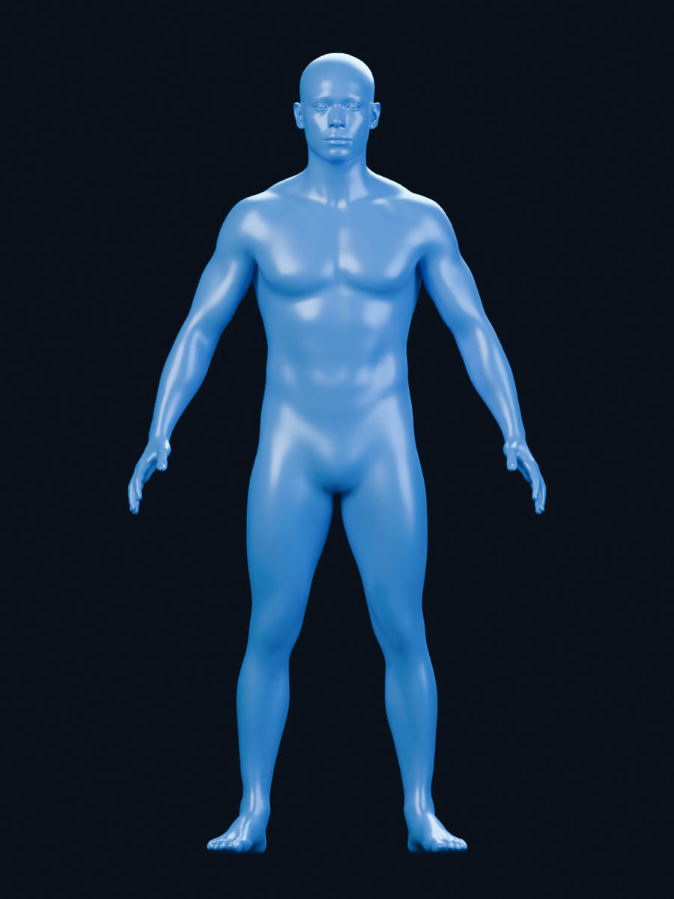
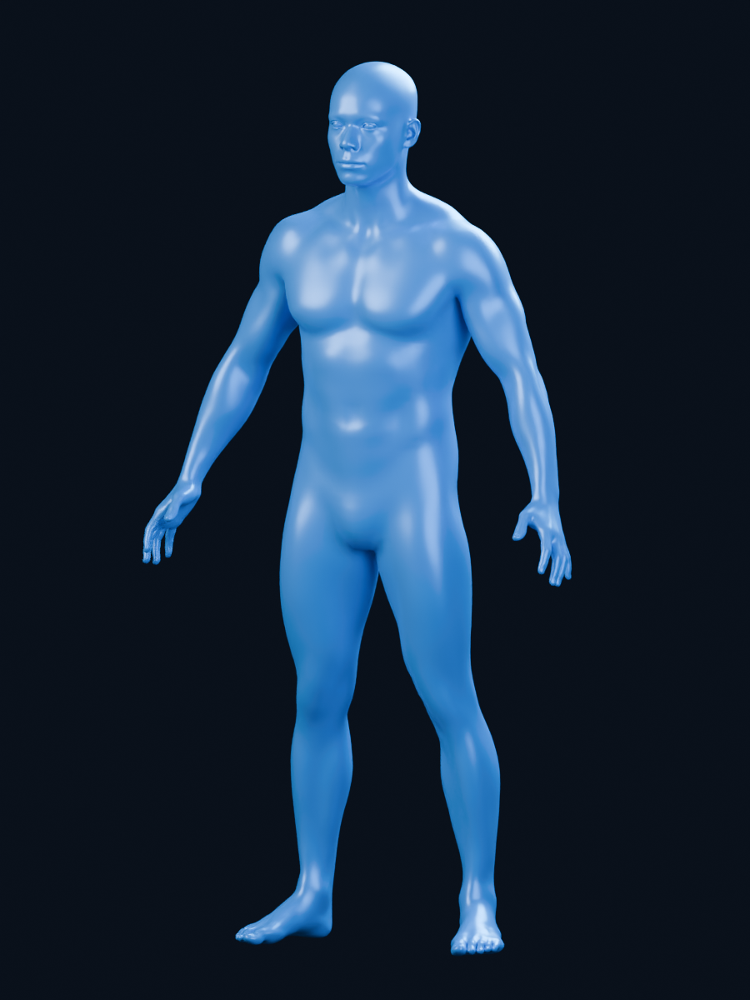

# Blue male body model for the HUD

A static model of a human body, prepared from Blender Studio's **Human Base Meshes v1.4.1 / Body Male - Realistic**.
It keeps the natural adult male proportions of the scan-based realistic model and has a blue material. Project Marvis shows it over the right palm, with the vitals around it.

[GLB model](hud_male_blue.glb) · [Blender file for editing](hud_male_blue.blend)

 

- The proportions of head, torso, arms and legs are those of the original realistic model.
- The whole body was scaled by one factor to a height of 1.80 m. The head and the legs were not stretched separately.
- It has a blue PBR material.
- The GLB and the Blender file hold only the three body meshes. The camera and the lights of the previews are not included.
- There is no rig for movement, no inner organs and no link to vital data.

## Files

- `hud_male_blue.glb`: the model for the web and for real-time 3D programs
- `hud_male_blue.blend`: the Blender file for editing material and shape
- `preview_front.png`: front render
- `preview_three_quarter.png`: three-quarter render
- `asset_info.json`: size, number of meshes, number of triangles, source
- `build_hud_male.py`: the script that prepares and exports the model and makes the previews
- `verify_asset.py`, `verification.json`: the script that loads the GLB again and checks it, and its result
- `fetch_source.py`: the script that downloads the official source ZIP and extracts the Blender library needed

The GLB is about 3.2 MB and has 86,856 triangles. The number of meshes, finite coordinates, the size and the number of triangles of the reloaded model were checked.

## Rebuilding

Python 3 and Blender 4.2 or later are needed. This result was made and checked with Blender 5.2.3 LTS.
Run the commands below in this folder. If the Blender executable is not on the PATH, use its full path.

```powershell
python fetch_source.py
blender --background --factory-startup --disable-autoexec --threads 8 --python build_hud_male.py
blender --background --factory-startup --disable-autoexec --threads 8 --python verify_asset.py
```

The official source ZIP in `source/` and the extracted library are not in the repository.
`fetch_source.py` downloads the official release at a fixed version and prepares it.

## Source and license

- Made by: Blender Studio and community contributors
- Distributed at: [Blender Demo Files](https://www.blender.org/download/demo-files/)
- Source ZIP: [Human Base Meshes v1.4.1](https://mirror.blender.org/demo/asset-bundles/human-base-meshes/human-base-meshes-bundle-v1.4.1.zip)
- On the scan-based replacement of the realistic male model: [Blender 4.0 Asset Bundles](https://archive.blender.org/wiki/2024/wiki/Reference/Release_Notes/4.0/Asset_Bundles.html)
- License of the model: [CC0 1.0](https://creativecommons.org/publicdomain/zero/1.0/)

We checked the CC0 statement for this bundle on the official download page. The prepared blue mesh files are provided under CC0 as well.
